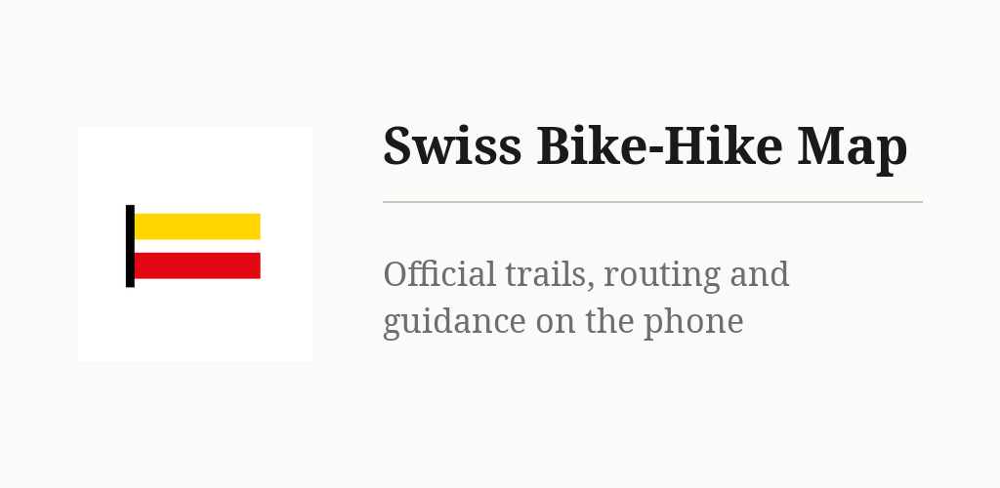
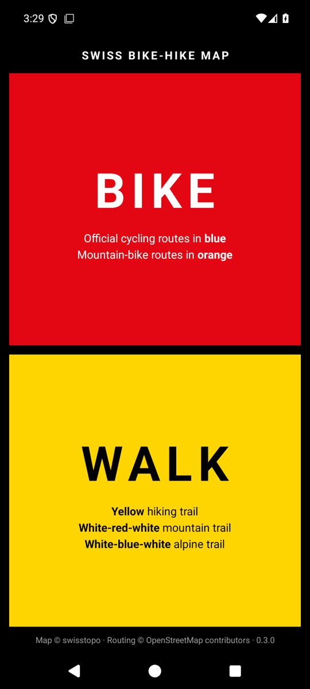
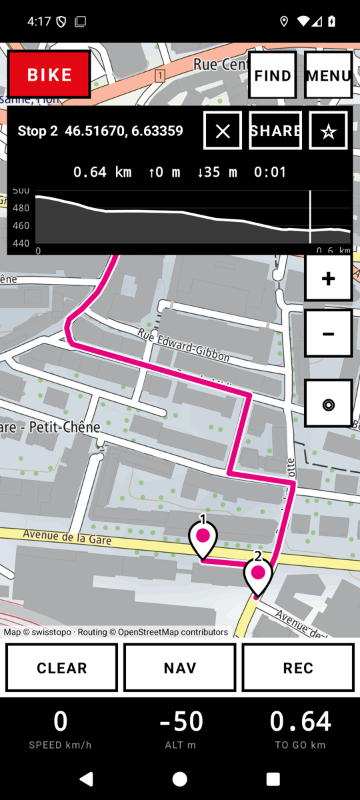
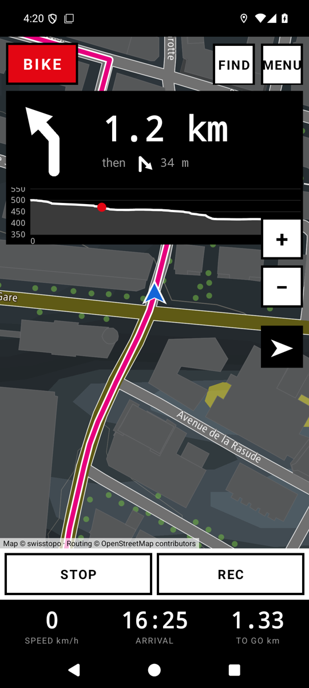

# Swiss Bikers and Pedestrians Map



A map for cycling, hiking and public transport in Switzerland, in the spirit of the old GPS
boxes: one screen, big buttons, the official hiking trails, cycling routes and public-transport
lines in their signpost colours on the swisstopo map. Routing and journey planning run on the
phone, with guidance that goes on with the screen off. No account, no tracking. (Until 0.5.1
the app was called Swiss Bike-Hike Map; the package name has not changed.)

## Key points

* **BIKE, WALK or PUBLIC TRANSPORT**, chosen on the first screen; the map then shows the official
  network of that mode: yellow / white-red-white / white-blue-white hiking trails, blue Veloland
  and orange mountain-bike routes, closures and detours (© swisstopo, © SchweizMobil); red
  railways, green trams and metros, purple lifts, blue boats and every stop with its name. The
  walking map shows the stops too, as plain dots.
* **Public transport**: GO offers the next journeys to your stop (departure, arrival, changes,
  lines, platforms), the chosen one is drawn leg by leg; NAV then says what to do in big letters
  (WALK to…, BOARD…, ON… get off at…, GET OFF at…, CHANGE), vibrates before boarding and before
  getting off, plans again when a connection is missed, and goes on in the notification. Online
  the timetable is transport.opendata.ch (real time, no key); offline, an optional 15 MB pack of
  the official Swiss timetable (opentransportdata.swiss), rebuilt weekly by this repository and
  planned on the phone. DEPARTURES on any stop pin; a STOPS tab in FIND on every map.
* **Stops**: a long press, a search result or a place shared by another app puts a numbered stop
  on the map; **GO** routes through all of them on the phone (BRouter on OpenStreetMap data,
  about 450 MB fetched once over Wi-Fi), with distance, climb, descent, time and an elevation
  profile.
* **NAV**: one big arrow, the distance to the turn, the next one, the time of arrival; a
  vibration before each turn; a new route when you leave the line; the trip goes on in a
  notification with the screen off or another app in front, and is kept in a local history.
* **PLAN**, on every map: a start (your position, a search, a point on the map), a destination,
  a date and a time; the itinerary in detail (turns and stops, or trains and buses with
  platforms), to share as text, keep in the app, show on the map, or follow at once with GO.
  On the transit map a tap on any stop dot lists its lines with their next departure.
* **GPX**: follow a track as it is (turns read off its shape), or record your own.
* **FIND**: places and addresses (GeoAdmin), typed coordinates (WGS84, LV95, LV03), people and
  firms from the search.ch directory with your own free key, public-transport stops, and your
  favourites, which you can import and export (GPX, KML, GeoJSON, CSV).
* **Offline**: save the area on screen or the whole country in one button (about 2.5 GB); the
  download survives the app being closed and the phone restarting, waits for Wi-Fi, and shows
  its progress in the menu and in a notification with PAUSE. Nothing is downloaded by itself:
  one button at the top of the menu updates every offline thing (saved areas, routing data,
  timetable) when you decide.
* **Night map** by hand or after sunset; share a place or your position as text; six languages
  (en, fr, de, es, pt, ru).
* Permissions: location, notifications (guidance and downloads), vibration. What leaves the phone:
  map tile requests, the downloads you ask for, the searches you type, and, on the transit map,
  your position sent to transport.opendata.ch to find the stops around you. No account, no
  tracking.

Data and sizes, the shape of the code and what was measured: [docs/NOTES.md](docs/NOTES.md).

## Install

- **F-Droid** (recommended, updates arrive by themselves): add the repository from [gallaz.ch/apps](https://gallaz.ch/apps/#fdroid), or the address `https://funkypitt.github.io/fdroid-repo/repo` in F-Droid.
- **Obtainium**: add `https://github.com/funkypitt/swiss-bike-hike-map` in Obtainium.
- **APK**: attached to the [latest release](../../releases/latest). No automatic updates.

All three deliver the same file, with the same signature. Android 9 or newer, arm64.

## Build

```
./gradlew assembleRelease
```

`local.properties` must point at an Android SDK. The `brouter` module is BRouter's routing core
(MIT) copied from upstream, see `brouter/UPSTREAM-COMMIT.txt`; the profiles and `lookups.dat`
are in `app/src/main/assets/brouter`.

The offline timetable pack is built by `tools/make-transit.py` from the official GTFS feed
(standard library only, about two minutes) and published on the rolling release `transit-data`
by the workflow `.github/workflows/transit-data.yml`, every Tuesday and on demand.

## Credits

Map: swisstopo vector base map and style, hiking trail network, Veloland and Mountainbikeland
routes, closures — © swisstopo, © SchweizMobil, free open government data.
Routing: [BRouter](https://github.com/abrensch/brouter) (MIT) on OpenStreetMap data (ODbL),
segments from brouter.de. Rendering: [MapLibre Native](https://maplibre.org) (BSD).
Search: GeoAdmin API; people and firms: search.ch directory (Swisscom Directories AG) with the
user's own key. Public transport: [transport.opendata.ch](https://transport.opendata.ch)
(Opendata.ch) online; the offline pack comes from the official Swiss timetable (GTFS) of
[opentransportdata.swiss](https://opentransportdata.swiss), open data of the Federal Office of
Transport, converted by this repository.

## Screenshots

<p>  </p>
